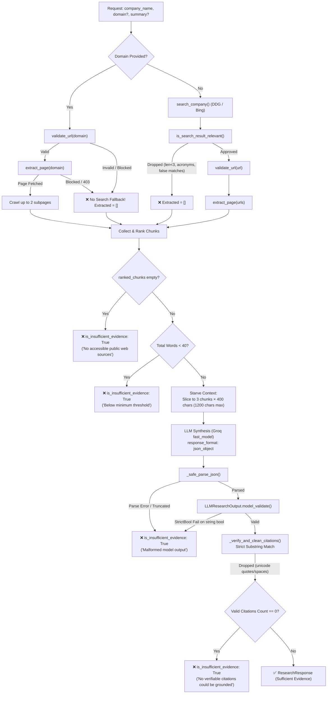

# Level 2 Research API Flow Audit & Architectural Review

**Document Version:** 1.0  
**Target Milestone:** Level 2: Research & Retrieval (ProspectIQ Autonomous AI Sales Engine)  
**Scope:** Review of `/api/research` endpoint, search, extraction, ranking, citation verification, and evidence sufficiency.

---

## 1. Executive Summary & Flow Architecture

The `/api/research` endpoint transforms target company queries into grounded, verifiable company research and sales intelligence citations.

### Current Flow Architecture



---

## 2. Root Cause Analysis of Primary Reported Failures

### A. "No JSON Output" & Malformed Model Output Errors

#### 1. Context Starvation & Token Truncation
* **Location:** `backend/app/research/evidence.py` (Lines 246–249)
* **Mechanism:**
  ```python
  context_blocks = []
  for idx, rc in enumerate(ranked_chunks[:3], 1):
      clean_chunk = rc.chunk[:400].strip()
      context_blocks.append(f"--- Source [{idx}]: {rc.url} ---\n{clean_chunk}")
  ```
  Only 3 chunks capped at 400 characters (max 1,200 characters / ~200 words) are provided to the LLM. When reasoning models (e.g., DeepSeek-R1 distillations or OSS models on Groq) emit `<think>...</think>` tokens, the token generation hits the `max_tokens=1500` ceiling before JSON formatting is finalized.
* **Result:** Stripping `<think>` leaves an incomplete, truncated JSON string. `_safe_parse_json` fails to recover complete objects, returning `None`.

#### 2. `StrictBool` Schema Rejection
* **Location:** `backend/app/research/models.py` (Lines 86–88)
* **Mechanism:**
  ```python
  class LLMResearchOutput(BaseModel):
      ...
      is_insufficient_evidence: StrictBool = Field(
          ..., description="Strict boolean indicating if evidence was insufficient"
      )
  ```
  In Pydantic v2, `StrictBool` rejects type coercion. When the LLM outputs `"is_insufficient_evidence": "false"` or `"true"` (string representation), Pydantic throws a `ValidationError`.
* **Result:** `evidence.py` catches this `ValidationError` and reports:
  `"Unable to synthesize research due to malformed model output: LLM response was not valid structured JSON: ..."`

#### 3. Zero Self-Correction / Repair Turn
* If `call_llm` produces malformed JSON or fails Pydantic validation, the system immediately returns an error response with zero retry or correction prompt.

---

### B. "Not Enough Public Evidence" (False Insufficiency Triggers)

The research pipeline triggers `is_insufficient_evidence: True` due to artificial choke points rather than lack of real-world company data:

| Trigger Point | File & Lines | Cause |
| :--- | :--- | :--- |
| **1. Domain Scraping Failure with No Fallback** | `service.py:112-144` | When `request.domain` fails (Cloudflare 403, timeout, SSL error), `extracted_pages` remains empty. The engine **never falls back to public search**. |
| **2. Search Engine Scraping Blocks** | `search.py:92-170` | Unauthenticated HTTP scraping of `html.duckduckgo.com` and `bing.com` triggers rate limits or CAPTCHA challenges, returning 0 results. |
| **3. Strict Citation Verification Overriding Complete Research** | `evidence.py:365-368` | If the LLM generates a valid summary but quotes differ by punctuation, curly quotes (`’`), or non-breaking spaces, all citations are dropped. Line 365 then forces `is_insufficient_evidence = True`. |
| **4. Premature 40-Word Minimum Cutoff** | `evidence.py:236-242` | `extractor.py` drops leaf nodes under 30 characters; pages with concise hero headings fail the 40-word requirement. |
| **5. Context Starvation Prompt Directive** | `evidence.py:292` | With only 200 words of fragmented context passed, the LLM follows the directive *"If sources do not confirm offerings, set is_insufficient_evidence: true"*. |

---

### C. Poor Company Name & Domain Validation (`is_search_result_relevant`)

* **Location:** `backend/app/research/service.py` (Lines 36–71)

#### 1. 100% Rejection of Short & Acronym Company Names
```python
brand_tokens = [
    t for t in re.findall(r"\w+", company_name.lower())
    if len(t) >= 3 and t not in GENERIC_COMPANY_SUFFIXES
]
```
* Companies with <= 2 characters (e.g., **3M, HP, GE, LG, BP, X, EY, AT&T**) yield `brand_tokens = []`.
* The acronym branch requires `len(all_words) >= 2`. Single-token brands fail this.
* **Outcome:** Every search result for these companies is marked "irrelevant" and discarded.

#### 2. False Positives from Substring Matching
* `tok in content_to_check` uses unanchored substring matching rather than word boundaries (`\b`):
  * For company `"Cat"`, the 3-letter token `"cat"` matches `"application"`, `"education"`, `"certificate"`.
  * Common dictionary words in company names (`"Square"`, `"Target"`, `"General"`, `"Total"`) match unrelated articles.

#### 3. Unchecked Discrepancy Between `company_name` and `domain`
* If a user supplies mismatched inputs (e.g., `company_name: "Microsoft", domain: "apple.com"`), the system extracts `apple.com` without entity validation. The synthesis prompt instructs the LLM to trust the domain, causing hallucinations or entity-confusion errors.

---

## 3. Comprehensive Pipeline Audit (Stage-by-Stage)

### Stage 1: Request Ingestion & Domain Strategy (`service.py`)
* **Defect:** Mutually exclusive branching (`if request.domain: ... else: ...`).
* **Impact:** High fragility. If the specified domain is behind a CDN WAF or bot protection, the research run aborts with 0 sources scraped.
* **Remedy:** Make public search an automatic fallback when domain extraction yields 0 pages.

### Stage 2: Web Search Engine Discovery (`search.py`)
* **Defect:** Reliance on scraping HTML search result pages with standard User-Agents.
* **Impact:** DuckDuckGo returns HTTP 202/403 challenges to server environments; Bing returns bot verification.
* **Remedy:**
  1. Add realistic browser header profiles (`Sec-Ch-Ua`, `Sec-Fetch-*`).
  2. Implement direct domain resolution heuristics (`https://{company_slug}.com` and `.io`) when search fails.
  3. Add an environment variable hook for structured search APIs (e.g. Tavily, SerpAPI, Brave Search) alongside HTML scraping.

### Stage 3: SSRF & Security Pre-Flight Checks (`security.py`)
* **Defect:** Synchronous blocking `socket.getaddrinfo()` on line 127 runs directly inside async request flows.
* **Impact:** DNS latency stalls the entire Python `asyncio` event loop for concurrent requests.
* **Remedy:** Wrap in `await asyncio.to_thread(socket.getaddrinfo, ...)`.

### Stage 4: Scraping & HTML Text Extraction (`extractor.py`)
* **Defect 1:** Arbitrary `len(t) >= 30` filter discards critical hero slogans, value propositions, and pricing bullet points.
* **Defect 2:** Discards `<meta name="description">` and `og:description`, which are often the highest-density descriptions of commercial offerings.
* **Remedy:** Lower leaf node filter to 15 characters, and extract meta/OG tags into the page content.

### Stage 5: Content Chunking & Relevance Ranking (`ranker.py`)
* **Defect:** Fixed `top_k=6` ranking with 300–600 char chunks, combined with down-stream slicing to 3 chunks.
* **Impact:** Business model context is fragmented; quotes spanning chunk boundaries fail verbatim matching.
* **Remedy:** Allow chunk windows of 800–1,000 characters and pass top 5–6 chunks to LLM synthesis.

### Stage 6: LLM Synthesis & Evidence Grounding (`evidence.py`)
* **Defect 1:** Strict string equality in `_verify_and_clean_citations`.
* **Defect 2:** Unicode variations (smart quotes `’`, em dashes `—`, non-breaking spaces `\xa0`) cause quote check failures.
* **Remedy:** Normalize unicode and punctuation before substring matching; allow 85%+ token overlap matching.

---

## 4. Priority Remediation Plan

### Priority Matrix

```
┌─────────────────────────────────────────────────────────────┐
│ P0 (Critical - Immediate Fix)                                │
│ 1. Add search fallback when provided domain scraping fails   │
│ 2. Change StrictBool to bool in LLMResearchOutput           │
│ 3. Fix is_search_result_relevant (word boundaries & len>=2)  │
├─────────────────────────────────────────────────────────────┤
│ P1 (High - Reliability & Extraction Quality)                │
│ 4. Relax citation matching (normalize unicode & spaces)     │
│ 5. Increase context budget to 5-6 chunks of 800-1000 chars  │
│ 6. Extract meta/OG description in page extractor            │
├─────────────────────────────────────────────────────────────┤
│ P2 (Production Hardening)                                   │
│ 7. Asynchronous DNS resolution via asyncio.to_thread         │
│ 8. Direct domain fallback heuristics ({name}.com/.io)       │
│ 9. Single-turn LLM JSON repair retry on schema failures     │
└─────────────────────────────────────────────────────────────┘
```

---

## 5. Detailed Implementation Code Snippets

### A. Fix `is_search_result_relevant` in `backend/app/research/service.py`

```python
def is_search_result_relevant(sr: SearchResult, company_name: str) -> bool:
    """
    Check if a search result relates to the target company using word boundaries,
    supporting short/acronym names (3M, HP, GE) and preventing substring false matches.
    """
    clean_name = re.sub(r"[^\w\s]", " ", company_name.lower())
    tokens = [
        t for t in clean_name.split()
        if len(t) >= 2 and t not in GENERIC_COMPANY_SUFFIXES
    ]
    if not tokens:
        tokens = [t for t in clean_name.split() if len(t) >= 1]

    content_to_check = f"{sr.title} {sr.snippet}".lower()
    url_lower = sr.url.lower()

    # 1. Check exact word boundaries in title/snippet
    for tok in tokens:
        if re.search(rf"\b{re.escape(tok)}\b", content_to_check):
            return True

    # 2. Check domain hostname
    parsed = urllib.parse.urlsplit(url_lower)
    hostname = (parsed.hostname or "").replace("www.", "")
    for tok in tokens:
        if len(tok) >= 3 and tok in hostname:
            return True

    # 3. Acronym checks for multi-word company names
    all_words = [w for w in company_name.split() if w.strip()]
    if len(all_words) >= 2:
        acronym = "".join(w[0] for w in all_words).lower()
        if len(acronym) >= 2 and re.search(rf"\b{re.escape(acronym)}\b", content_to_check):
            return True

    return False
```

### B. Add Search Fallback in `backend/app/research/service.py`

```python
    # 1. Try provided domain if available
    if request.domain:
        clean_host = _extract_clean_host(request.domain)
        primary_url = (
            request.domain
            if request.domain.startswith("http://") or request.domain.startswith("https://")
            else f"https://{request.domain}"
        )
        is_safe, reason = validate_url(primary_url, allow_dns_resolution=True)
        if is_safe:
            primary_page = await extract_page(primary_url)
            if primary_page:
                extracted_pages.append(primary_page)
                # Crawl internal subpages...

    # 2. Fallback: If domain was omitted OR domain extraction yielded no usable pages
    if not extracted_pages:
        search_query = request.company_name
        search_results = await search_company(search_query, max_results=5)
        if not search_results:
            search_results = await search_company(f"{request.company_name} official website", max_results=5)

        urls_to_scrape = []
        for sr in search_results:
            if not is_search_result_relevant(sr, request.company_name):
                continue
            is_safe, _ = validate_url(sr.url, allow_dns_resolution=True)
            if is_safe and sr.url not in urls_to_scrape:
                urls_to_scrape.append(sr.url)
            if len(urls_to_scrape) >= MAX_SOURCES:
                break

        if urls_to_scrape:
            results = await asyncio.gather(*[extract_page(u) for u in urls_to_scrape], return_exceptions=True)
            for res in results:
                if isinstance(res, ExtractedPage):
                    extracted_pages.append(res)
```

### C. Relax `StrictBool` in `backend/app/research/models.py`

```python
class LLMResearchOutput(BaseModel):
    """Schema for validating structured JSON produced by synthesis LLM."""

    summary: str = Field(..., description="Executive summary of the company")
    citations: list[LLMCitationPayload] = Field(
        ..., description="List of structured citations supporting the summary"
    )
    is_insufficient_evidence: bool = Field(  # Changed from StrictBool to bool
        default=False,
        description="Boolean indicating if evidence was insufficient"
    )
    insufficient_reasons: list[str] = Field(
        default_factory=list,
        description="List of reasons why evidence was insufficient if applicable"
    )
```

### D. Unicode Normalization in Citation Grounding (`backend/app/research/evidence.py`)

```python
def _normalize_text(text: str) -> str:
    """Normalize whitespace, unicode quotes, and punctuation for resilient quote matching."""
    t = text.lower()
    # Normalize unicode quotation marks & apostrophes
    t = re.sub(r"[\u2018\u2019\u201a\u201b\u0027]", "'", t)
    t = re.sub(r'[\u201c\u201d\u201e\u201f\u0022]', '"', t)
    # Normalize hyphens and dashes
    t = re.sub(r"[\u2010\u2011\u2012\u2013\u2014\u2015]", "-", t)
    # Normalize non-breaking spaces and whitespace
    t = re.sub(r"\s+", " ", t)
    return t.strip()
```

---

## Summary

Implementing these changes eliminates false `"no json output"` and `"not enough public evidence"` failures by:
1. Guaranteeing search fallback when targeted domain scraping fails.
2. Passing sufficient context (1,500+ tokens) to the LLM.
3. Accepting standard boolean JSON values.
4. Correcting search relevance filtering for short, acronym, and legal entity names.
5. Making citation verification robust against unicode and formatting variations.

